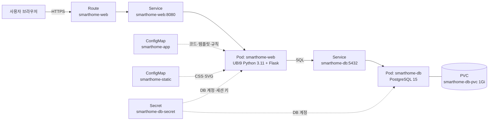
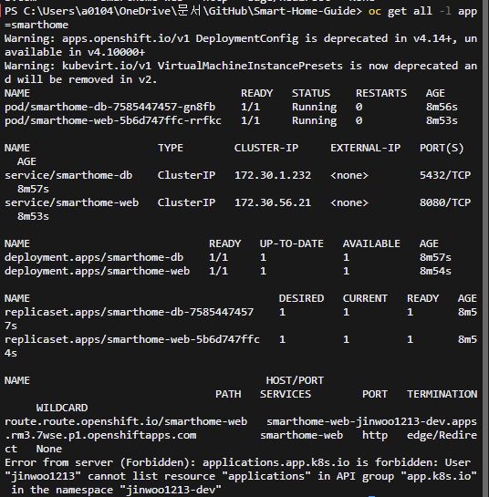
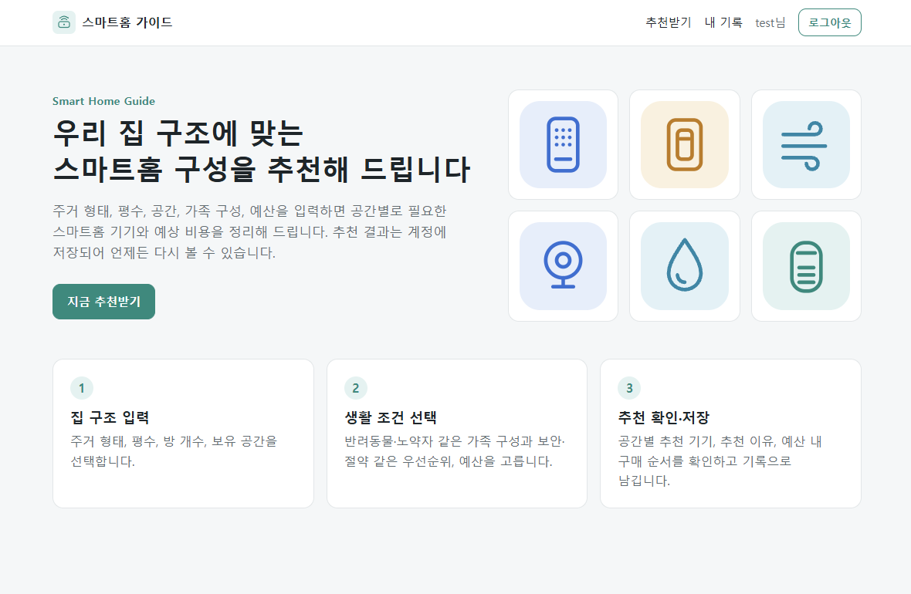
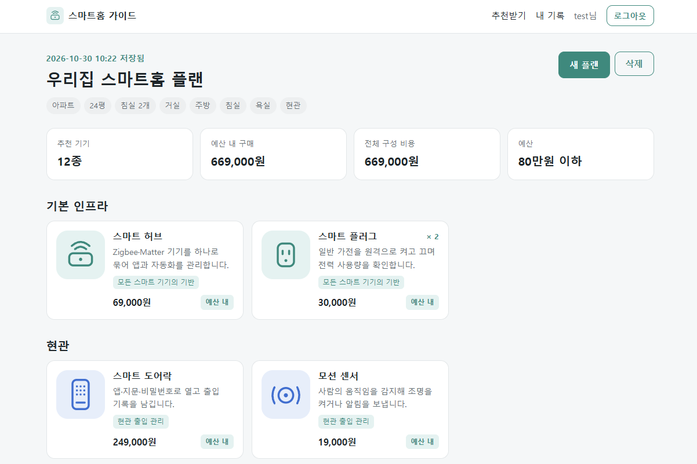

# 스마트홈 가이드 (Smart Home Guide)

> 집 구조를 입력하면 공간별로 필요한 스마트홈 기기와 예상 비용을 추천하고, 그 결과를 계정에 저장하는 웹 + DB 2-tier 서비스

| 항목 | 내용 |
|---|---|
| 학번 | 202121161 |
| 과목 | 지능형IoT플랫폼 · 나만의 컨테이너 만들기 |
| 배포 환경 | Red Hat Developer Sandbox (OpenShift) |
| 배포 명령 | `oc apply -f k8s/` |

---

## 1. 컨테이너 소개

### 서비스 이름
**스마트홈 가이드**: 우리 집 구조에 맞는 스마트홈 구성 추천 서비스

### 한 줄 설명
주거 형태, 평수, 공간, 가족 구성, 우선순위, 예산을 폼으로 입력하면 규칙 기반으로 공간별 스마트홈 기기와 예상 비용을 추천하고, 결과를 계정별로 저장합니다.

### 주제를 고른 이유
- **수업과의 연결**: 지능형 IoT 플랫폼 수업에서 다루는 IoT 기기들이 실제 생활에서 가장 많이 쓰이는 곳이 스마트홈입니다.
- **해결하려는 문제**: 스마트홈을 처음 꾸미는 사람은 "무엇부터, 몇 개를, 얼마 예산으로 사야 하는지"를 판단하기 어렵습니다. 집 구조와 생활 조건만 입력하면 구성안을 정리해 주는 서비스가 필요하다고 생각했습니다.

### 주요 기능

| 기능 | 설명 |
|---|---|
| 회원가입 / 로그인 | 비밀번호는 해시(werkzeug PBKDF2)로 저장하고, 세션 쿠키는 Secret에 있는 키로 서명합니다. 재배포로 DB가 초기화되어 쿠키 속 사용자가 없어지면 다시 로그인하도록 안내합니다 |
| 집 정보 입력 | 주거 형태, 평수, 침실 수, 보유 공간, 가족 구성, 우선순위, 예산을 폼으로 입력합니다 |
| 규칙 기반 추천 | `rules.json`의 규칙 21개와 제품 24종을 조건에 맞춰 적용합니다. 공간별 추천 기기, 추천 이유, 수량, 예상 가격을 보여줍니다 |
| 예산 반영 | 우선순위가 높은 기기부터 예산 안에 담고, 예산을 넘는 기기는 "추후 구매"로 표시합니다 |
| 기록 저장·조회·삭제 | 추천 결과를 PostgreSQL에 저장하고 "내 기록"에서 다시 볼 수 있습니다. 다른 사용자의 기록은 조회하거나 삭제할 수 없습니다(404) |
| 제품 예시 이미지 | 제품마다 SVG 아이콘을 직접 만들어 ConfigMap으로 제공합니다 |

### 입력 항목

| 항목 | 선택지 |
|---|---|
| 주거 형태 | 아파트, 오피스텔, 원룸, 단독주택 |
| 평수 / 침실 수 | 숫자 입력 (5~200평 / 1~8개) |
| 보유 공간 | 거실, 주방, 침실, 서재, 욕실, 현관, 베란다 (복수 선택) |
| 가족 구성 | 1인 가구, 반려동물, 노약자, 영유아 (복수 선택) |
| 우선순위 | 보안, 에너지 절약, 생활 편의, 화재·가스 안전 (복수 선택) |
| 예산 | 30만원 이하, 80만원 이하, 제한 없음 |

### 추천 규칙 예시 (`src/app/rules.json`)

| 조건 | 추천 기기 |
|---|---|
| 항상 | 스마트 허브, 스마트 플러그 ×2 |
| 30평 이상 또는 단독주택 | 메시 Wi-Fi |
| 현관 | 스마트 도어락, 모션 센서 |
| 거실 | 스마트 조명 스위치, 공기질 센서, IR 리모컨 |
| 주방 | 가스 누출 감지기, 연기 감지기 |
| 침실 | 스마트 전구·온습도 센서 (침실 수만큼) |
| 욕실 / 베란다 | 누수 센서 / 누수 센서, 문열림 센서 |
| 반려동물 | 펫 카메라, 자동 급식기 |
| 노약자 | 낙상 감지 센서, 비상 호출 버튼 |
| 영유아 | 실내 홈캠, 문열림 센서, 연기 감지기 |
| 보안 우선 | 문열림 센서 (침실 수만큼), 실내 홈캠 (+ 단독주택이면 실외 보안 카메라) |
| 에너지 절약 우선 | 스마트 플러그 ×4, 전력량 모니터 |
| 생활 편의 우선 | AI 스피커 (+ 거실이 있으면 스마트 커튼 모터) |
| 안전 우선 | 연기 감지기 (+ 주방이 있으면 스마트 가스밸브) |

같은 기기가 여러 규칙에 걸리면 하나로 합치고, 추천 이유는 모두 표시하며, 수량은 가장 큰 값을 씁니다. 규칙은 JSON 파일이라서 코드를 고치지 않고 ConfigMap만 바꿔 수정할 수 있습니다.

### 화면과 주소

| 경로 | 내용 | 로그인 필요 |
|---|---|---|
| `/` | 메인 (서비스 소개, 사용 방법) | |
| `/signup`, `/login`, `/logout` | 회원가입, 로그인, 로그아웃 | |
| `/plan` | 집 정보 입력 → 추천 결과 저장 | ✔ |
| `/history` | 내 추천 기록 목록 | ✔ |
| `/history/<id>` | 추천 결과 상세 (삭제 버튼 포함) | ✔ |
| `/healthz` | Liveness 확인용 (웹 프로세스 응답) | |
| `/readyz` | Readiness 확인용 (DB 연결 확인) | |

---

## 2. 아키텍처

### 구성도



**요청 흐름**: 사용자 → Route(HTTPS, edge TLS) → Service `smarthome-web` → web Pod → Service `smarthome-db` → db Pod → PVC

### 사용한 Object

| Object | 이름 | 파일 | 역할 |
|---|---|---|---|
| Secret | `smarthome-db-secret` | `secret.yaml` | DB 이름·사용자·비밀번호와 Flask 세션 서명 키. web과 db가 같은 값을 환경변수로 참조합니다 |
| PersistentVolumeClaim | `smarthome-db-pvc` | `pvc.yaml` | PostgreSQL 데이터 디렉터리(`/var/lib/pgsql/data`)를 1Gi 영구 저장소에 둡니다. DB Pod가 다시 만들어져도 계정과 기록이 유지됩니다 |
| Deployment | `smarthome-db` | `db-deployment.yaml` | PostgreSQL 15 실행. RWO PVC는 한 Pod만 붙을 수 있으므로 `strategy: Recreate`로 기존 Pod를 먼저 내립니다 |
| Service | `smarthome-db` | `db-service.yaml` | 클러스터 내부 전용 DB 주소. web이 `smarthome-db:5432`로 접속합니다 |
| ConfigMap | `smarthome-app` | `configmap-app.yaml` | `app.py`, HTML 템플릿 7개, `rules.json`. web Pod의 `/opt/app`에 마운트합니다 |
| ConfigMap | `smarthome-static` | `configmap-static.yaml` | `style.css`와 제품 SVG 24개. web Pod의 `/opt/static`에 마운트합니다 |
| Deployment | `smarthome-web` | `web-deployment.yaml` | Flask 웹앱. 시작할 때 pip로 Flask·psycopg2를 설치한 뒤 ConfigMap의 `app.py`를 실행합니다 |
| Service | `smarthome-web` | `web-service.yaml` | web Pod의 8080 포트를 묶는 내부 주소 |
| Route | `smarthome-web` | `route.yaml` | 외부 HTTPS 주소. host는 OpenShift가 자동으로 만들고, HTTP 요청은 HTTPS로 리다이렉트합니다 |

모든 Object에 `app: smarthome` 라벨을 붙이고 `component: web` / `component: db`로 구분했습니다. Service selector도 이 두 라벨로 Pod를 찾습니다. `app.kubernetes.io/part-of`와 `app.openshift.io/connects-to`를 지정해서 웹 콘솔 Topology에서 web → db 연결이 한 그룹으로 보이게 했습니다.

### Probe 설계

| Probe | 대상 | 설정 | 목적 |
|---|---|---|---|
| startupProbe | web `/healthz` | 5초 간격, 최대 60회 (5분) | pip 설치와 DB 연결 대기 동안 liveness가 Pod를 죽이지 않도록 보호 |
| livenessProbe | web `/healthz` | 20초 간격 | 웹 프로세스만 확인. DB 장애 때문에 web Pod가 불필요하게 재시작되지 않게 분리 |
| readinessProbe | web `/readyz` | 10초 간격 | DB `SELECT 1`까지 성공해야 Route 트래픽을 받음 |
| readinessProbe | db `pg_isready` | 10초 간격 | PostgreSQL이 접속을 받을 수 있는 상태인지 확인 |
| livenessProbe | db TCP 5432 | 30초 후부터 20초 간격 | DB 프로세스가 포트를 열고 있는지 확인 |

### 리소스 설정

| 컨테이너 | requests (CPU / 메모리) | limits (CPU / 메모리) |
|---|---|---|
| web | 50m / 128Mi | 500m / 384Mi |
| db | 100m / 256Mi | 500m / 512Mi |

Sandbox 할당량 안에서 동작하도록 작게 잡았습니다. web의 메모리 limit은 시작 시 pip 설치에 필요한 여유를 고려했습니다.

### 환경변수

| 컨테이너 | 변수 | 값 / 출처 |
|---|---|---|
| web | `DB_HOST`, `DB_PORT` | `smarthome-db`, `5432` (Service 이름으로 접속) |
| web | `DB_NAME`, `DB_USER`, `DB_PASSWORD` | Secret `smarthome-db-secret` |
| web | `SECRET_KEY` | Secret `smarthome-db-secret` (세션 쿠키 서명) |
| web | `APP_DIR`, `STATIC_DIR`, `PYTHONPATH` | `/opt/app`, `/opt/static`, `/tmp/pylib` |
| db | `POSTGRESQL_DATABASE`, `POSTGRESQL_USER`, `POSTGRESQL_PASSWORD` | Secret `smarthome-db-secret` (첫 실행 시 DB와 계정 생성) |

### DB 스키마

앱이 시작할 때 `CREATE TABLE IF NOT EXISTS`로 직접 만듭니다. 별도의 초기화 스크립트는 없습니다.

```sql
users (id, username UNIQUE, password_hash, created_at)
plans (id, user_id → users.id ON DELETE CASCADE, title, house_input(JSON), result(JSON), created_at)
```

web과 db Pod가 동시에 시작되므로, 앱은 DB에 연결될 때까지 최대 60초(2초 × 30회) 재시도한 뒤 테이블을 만듭니다.

---

## 3. 사용 이미지

| 컴포넌트 | 이미지 주소 | 태그 | 노출 포트 | 선택 이유 |
|---|---|---|---|---|
| web | `registry.access.redhat.com/ubi9/python-311` | `latest` | 8080 | Red Hat UBI 이미지라 OpenShift의 비루트 임의 UID 실행을 지원하고, Docker Hub 다운로드 제한이 없습니다. 코드는 ConfigMap으로 주입하므로 이미지 빌드가 필요 없습니다 |
| db | `quay.io/sclorg/postgresql-15-c9s` | `latest` | 5432 | OpenShift용으로 만들어진 sclorg 이미지라 비루트 실행과 PVC 권한 문제가 없고, `POSTGRESQL_*` 환경변수만으로 초기화됩니다. quay.io 공개 이미지입니다 |

두 포트 모두 1024 이상이라 비루트 사용자도 사용할 수 있습니다.

---

## 4. 배포 방법

### 배포

```bash
git clone https://github.com/Greenviee/Smart-Home-Guide.git
cd Smart-Home-Guide/students/202121161
oc apply -f k8s/
```

`oc apply`가 파일을 알파벳 순서로 적용하기 때문에 Deployment가 Secret·PVC보다 먼저 만들어질 수 있습니다. 이 경우 Pod가 몇 초간 `CreateContainerConfigError`나 `Pending` 상태로 기다리다가, Secret과 PVC가 생기면 자동으로 시작됩니다.

### 배포 후 확인

```bash
oc get pods -l app=smarthome -w                        # db, web 모두 1/1 Running이 될 때까지 대기 (web은 pip 설치로 1~2분)
oc logs deploy/smarthome-web                           # "[init_db] 준비 완료 (PostgreSQL)" 확인
oc get route smarthome-web -o jsonpath='{.spec.host}'  # 접속 주소 확인
```

| 확인 항목 | 접속 경로 | 예상 화면 / 응답 |
|---|---|---|
| 메인 화면 | `https://<route-host>/` | 서비스 소개와 "지금 추천받기" 버튼 |
| 회원가입·로그인 | `/signup` → `/login` | 로그인 후 "추천받기" 화면으로 이동 |
| 추천 | `/plan`에서 입력 후 제출 | 공간별 추천 카드, 예산 내 구매 금액, 전체 비용 |
| 기록 | `/history` | 저장된 플랜 목록 |
| 헬스 체크 | `curl https://<route-host>/readyz` | `{"db":"postgresql","status":"ready"}` |

### 데이터 유지(PVC) 확인

```bash
oc delete pod -l component=db    # DB Pod 삭제 → Deployment가 새 Pod 생성
```

새 DB Pod가 Running이 된 뒤 다시 접속하면 기존 계정과 기록이 그대로 남아 있습니다.

### 재현성 확인 (채점 방식)

```bash
oc delete -f k8s/
oc apply -f k8s/
```

PVC도 함께 지워지므로 새로 배포된 DB는 빈 상태로 시작합니다.

### 코드를 수정할 때

`src/app`, `src/static`을 고친 뒤 ConfigMap YAML을 다시 만들어 적용합니다.

```bash
python src/build_configmaps.py
oc apply -f k8s/
oc rollout restart deployment/smarthome-web
```

### 로컬 실행

`DB_HOST` 환경변수가 없으면 PostgreSQL 대신 SQLite 파일로 동작합니다.

```bash
pip install flask
python src/app/app.py            # http://localhost:8080
```

---

## 5. 배포 결과

GitHub에서 새로 clone한 `k8s/` 폴더만으로 Developer Sandbox(`jinwoo1213-dev`)에 배포한 결과입니다.

### `oc get all -l app=smarthome`

```text
NAME                                 READY   STATUS    RESTARTS   AGE
pod/smarthome-db-7585447457-gn8fb    1/1     Running   0          8m56s
pod/smarthome-web-5b6d747ffc-rrfkc   1/1     Running   0          8m53s

NAME                    TYPE        CLUSTER-IP     EXTERNAL-IP   PORT(S)    AGE
service/smarthome-db    ClusterIP   172.30.1.232   <none>        5432/TCP   8m57s
service/smarthome-web   ClusterIP   172.30.56.21   <none>        8080/TCP   8m53s

NAME                            READY   UP-TO-DATE   AVAILABLE   AGE
deployment.apps/smarthome-db    1/1     1            1           8m57s
deployment.apps/smarthome-web   1/1     1            1           8m54s

NAME                                       DESIRED   CURRENT   READY   AGE
replicaset.apps/smarthome-db-7585447457    1         1         1       8m57s
replicaset.apps/smarthome-web-5b6d747ffc   1         1         1       8m54s

NAME                                     HOST/PORT                                                         SERVICES        PORT   TERMINATION     WILDCARD
route.route.openshift.io/smarthome-web   smarthome-web-jinwoo1213-dev.apps.rm3.7wse.p1.openshiftapps.com   smarthome-web   http   edge/Redirect   None
```



| 확인 항목 | 결과 |
|---|---|
| Pod | db, web 모두 `1/1 Running`, 재시작 0회 |
| PVC `smarthome-db-pvc` | `Bound` (1Gi, gp3) |
| Route | `edge/Redirect` (HTTPS) |
| `/readyz` 응답 | `{"db":"postgresql","status":"ready"}` |

### 메인 화면 (로그인 후)



### 추천 결과 화면

아파트, 24평, 침실 2개, 거실·주방·침실·욕실·현관, 예산 80만원 이하로 입력한 결과입니다. 12종 669,000원이 추천되었고, 결과는 PostgreSQL에 저장되었습니다.



---

## 6. 어려웠던 점

### web이 DB보다 먼저 뜨는 문제
- **문제**: `oc apply` 한 번으로 두 Pod가 동시에 시작되므로, web이 DB보다 먼저 준비되면 테이블 생성에 실패할 수 있습니다.
- **해결**: 앱의 `init_db()`가 DB 연결을 최대 60초 재시도하도록 했습니다. 또 readiness Probe가 DB 연결 전까지 트래픽을 막도록 구성했습니다.

### 재배포 후 추천 저장 시 500 에러
- **문제**: 재현성 검증(`oc delete -f k8s/` → `oc apply -f k8s/`)을 한 뒤 "추천 결과 보기"를 누르자 Internal Server Error가 발생했습니다.
- **원인 확인**: `oc logs deploy/smarthome-web`에서 아래 에러를 확인했습니다.
  ```text
  psycopg2.errors.ForeignKeyViolation: insert or update on table "plans" violates foreign key constraint "plans_user_id_fkey"
  DETAIL:  Key (user_id)=(1) is not present in table "users".
  ```
  재배포 때 PVC까지 삭제되어 DB가 초기화됐는데, 브라우저에는 이전 로그인 쿠키(`user_id=1`)가 남아 있었습니다. 앱이 쿠키만 믿고 존재하지 않는 사용자로 플랜을 저장하려다 실패한 것입니다.
- **해결**: 로그인이 필요한 페이지마다 세션의 사용자가 DB에 실제로 있는지 확인하도록 했습니다. 없으면 세션을 지우고 "로그인 정보가 만료되었습니다" 안내와 함께 로그인 화면으로 보냅니다.
- **반영**: ConfigMap을 다시 생성해 적용하고 `oc rollout restart deployment/smarthome-web`으로 반영한 뒤 정상 동작을 확인했습니다.

---

## 7. AI·참고자료 활용 내역

### AI 도구

| 도구 | 용도 |
|---|---|
| Claude (Claude Code) | 주제의 난이도 적합성 검토 |
| Claude (Claude Code) | 웹 프론트엔드 구성: 메인·입력 폼·추천 결과·기록 화면 설계와 모바일 반응형 레이아웃 적용 |
| Claude (Claude Code) | README 작성: 필수 7개 섹션 구성, 아키텍처·Object·Probe 설계 설명 정리 |
| Claude (Claude Code) | 최종 테스트 진행: Sandbox 배포 상태(Pod, Route, `/readyz`) 점검과 회원가입 → 로그인 → 추천 저장 흐름 검증 |
| Claude (Claude Code) | Git 커밋 자동화: 변경 사항 정리와 커밋 메시지 작성 |


## 폴더 구조

```text
students/202121161/
├── README.md
├── k8s/                         ← 채점 대상 (oc apply -f k8s/)
│   ├── configmap-app.yaml       ← src/app 에서 자동 생성
│   ├── configmap-static.yaml    ← src/static 에서 자동 생성
│   ├── db-deployment.yaml
│   ├── db-service.yaml
│   ├── pvc.yaml
│   ├── route.yaml
│   ├── secret.yaml
│   ├── web-deployment.yaml
│   └── web-service.yaml
├── src/
│   ├── app/                     ← app.py, HTML 템플릿 7개, rules.json
│   ├── static/                  ← style.css, 제품 SVG 24개
│   └── build_configmaps.py      ← src → k8s/configmap-*.yaml 변환 스크립트
└── images/                      ← 배포 결과 캡처
    ├── main.png
    ├── oc-get-all.png
    └── result.png
```
