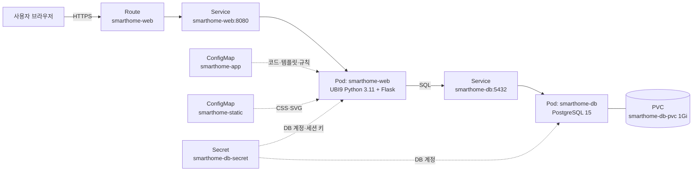

# 스마트홈 가이드 (Smart Home Guide)

> 집 구조를 입력하면 공간별로 필요한 스마트홈 기기와 예상 비용을 추천하고, 그 결과를 계정에 저장하는 웹 + DB 2-tier 서비스

- 학번: 202121161
- 과목: 지능형IoT플랫폼 · 나만의 컨테이너 만들기 (난이도: **심화**)

---

## 1. 컨테이너 소개

| 항목 | 내용 |
|---|---|
| 서비스 이름 | 스마트홈 가이드 |
| 한 줄 설명 | 주거 형태·평수·공간·가족 구성·예산을 폼으로 입력하면 규칙 기반으로 스마트홈 기기 구성을 추천 |
| 주제 선정 이유 | IoT 플랫폼 수업 주제와 맞닿아 있고, 스마트홈을 처음 꾸미는 사람이 "무엇부터 사야 하는지" 막막한 문제를 해결하고 싶었음. 사용자 계정과 추천 기록을 DB에 저장해야 하므로 웹 + DB 2-tier, PVC, 다중 Deployment를 모두 활용할 수 있음 |

**주요 기능**

1. **회원가입 / 로그인**: 비밀번호는 해시(werkzeug PBKDF2)로 저장, 세션 쿠키는 Secret의 키로 서명
2. **집 정보 입력 폼**: 주거 형태, 평수, 침실 수, 보유 공간(거실·주방·침실·서재·욕실·현관·베란다), 가족 구성(1인 가구·반려동물·노약자·영유아), 우선순위(보안·에너지 절약·생활 편의·안전), 예산
3. **규칙 기반 추천**: `rules.json`의 21개 규칙과 24개 제품을 조건에 맞춰 적용 → 공간별 추천, 추천 이유, 수량(침실 수만큼 등), 예상 가격
4. **예산 반영**: 우선순위가 높은 기기부터 예산 안에 담고, 나머지는 "추후 구매"로 표시
5. **추천 기록 저장·조회·삭제**: 결과를 PostgreSQL에 저장하고 "내 기록"에서 다시 확인 (다른 사용자의 기록은 접근 불가)

## 2. 아키텍처



**흐름**: 사용자 → Route(HTTPS, edge TLS) → Service(smarthome-web) → web Pod → Service(smarthome-db) → db Pod → PVC

| Object | 이름 | 역할 |
|---|---|---|
| Secret | `smarthome-db-secret` | DB 이름·사용자·비밀번호, Flask 세션 서명 키. web과 db가 같은 값을 환경변수로 참조 |
| PersistentVolumeClaim | `smarthome-db-pvc` | PostgreSQL 데이터 디렉터리(`/var/lib/pgsql/data`) 영구 저장. Pod를 지워도 계정·기록 유지 |
| Deployment | `smarthome-db` | PostgreSQL 15. RWO PVC를 쓰므로 `strategy: Recreate`. readiness(`pg_isready`), liveness(TCP 5432) Probe |
| Service | `smarthome-db` | 클러스터 내부 전용 DB 주소. web이 `smarthome-db:5432`로 접속 |
| ConfigMap | `smarthome-app` | `app.py`, HTML 템플릿 7개, `rules.json`(추천 규칙·제품 목록). `/opt/app`에 마운트 |
| ConfigMap | `smarthome-static` | `style.css`, 제품 예시 이미지 SVG 24개. `/opt/static`에 마운트 |
| Deployment | `smarthome-web` | Flask 웹앱. 시작 시 pip로 Flask·psycopg2 설치 후 실행. startup/liveness(`/healthz`), readiness(`/readyz`, DB 연결 확인) Probe |
| Service | `smarthome-web` | web Pod의 8080 포트를 묶는 내부 주소 |
| Route | `smarthome-web` | 외부 HTTPS 접속 주소 (host 자동 생성, HTTP는 HTTPS로 리다이렉트) |

**Probe 설계**

- `startupProbe` (`/healthz`, 최대 5분): 컨테이너 시작 시 pip 설치와 DB 연결 대기에 시간이 걸리므로, 그동안 liveness가 Pod를 죽이지 않도록 보호
- `livenessProbe` (`/healthz`): 웹 프로세스만 확인. DB 장애 때문에 web Pod가 불필요하게 재시작되지 않게 분리
- `readinessProbe` (`/readyz`): DB `SELECT 1`까지 성공해야 Route 트래픽을 받음

**DB 스키마** (앱이 시작할 때 `CREATE TABLE IF NOT EXISTS`로 생성)

```sql
users(id, username UNIQUE, password_hash, created_at)
plans(id, user_id → users.id, title, house_input(JSON), result(JSON), created_at)
```

## 3. 사용 이미지

| 컴포넌트 | 이미지 | 노출 포트 | 선택 이유 |
|---|---|---|---|
| web | `registry.access.redhat.com/ubi9/python-311:latest` | 8080 | Red Hat UBI 이미지라 OpenShift의 임의 UID(비루트) 실행을 지원하고 Docker Hub 다운로드 제한이 없음. 코드는 ConfigMap으로 주입하므로 이미지 빌드 불필요 |
| db | `quay.io/sclorg/postgresql-15-c9s:latest` | 5432 | OpenShift용으로 만들어진 sclorg 이미지라 비루트 실행·PVC 권한 문제가 없고, `POSTGRESQL_USER/PASSWORD/DATABASE` 환경변수만으로 초기화됨. quay.io 공개 이미지 |

## 4. 배포 방법

```bash
git clone https://github.com/Greenviee/Smart-Home-Guide.git
cd Smart-Home-Guide/students/202121161
oc apply -f k8s/
```

**확인 방법**

```bash
oc get pods -l app=smarthome -w        # smarthome-db, smarthome-web 모두 1/1 Running 대기 (web은 pip 설치로 1~2분 소요)
oc get route smarthome-web -o jsonpath='{.spec.host}'
```

- 브라우저로 `https://<route-host>` 접속 → 메인 화면
- 회원가입 → 로그인 → "추천받기"에서 집 정보 입력 → 공간별 추천 결과 화면 → "내 기록"에 저장된 플랜 확인
- 헬스 체크: `curl https://<route-host>/readyz` → `{"db":"postgresql","status":"ready"}`

**데이터 유지(PVC) 확인**

```bash
oc delete pod -l component=db          # DB Pod 강제 삭제 → Deployment가 새 Pod 생성
# 새 Pod가 Running이 된 뒤 다시 로그인하면 기존 계정과 기록이 그대로 남아 있음
```

**코드 수정 시**: `src/app`, `src/static`을 고친 뒤 ConfigMap YAML을 다시 생성하고 적용합니다.

```bash
python src/build_configmaps.py
oc apply -f k8s/
oc rollout restart deployment/smarthome-web
```

**로컬 실행** (DB_HOST 환경변수가 없으면 SQLite로 동작)

```bash
pip install flask
python src/app/app.py                 # http://localhost:8080
```

## 5. 배포 결과

> TODO: Sandbox 배포 후 캡처를 `images/`에 넣고 아래 링크를 채웁니다.

```text
(oc get all -l app=smarthome 출력 붙여넣기)
```


## 6. 어려웠던 점

- **이미지 빌드 없이 직접 만든 코드 실행**: 과제 조건상 이미지를 빌드할 수 없어, 공개 Python 이미지에 코드를 ConfigMap으로 마운트하고 시작 명령에서 의존성을 설치하는 방식으로 해결. OpenShift는 임의 UID로 실행되므로 쓰기 권한이 보장되는 `/tmp/pylib`에 설치하고 `PYTHONPATH`로 지정
- **web이 DB보다 먼저 뜨는 문제**: `oc apply` 시 두 Pod가 동시에 시작되므로 앱의 `init_db()`가 DB 연결을 최대 60초 재시도하고, readiness Probe가 DB 연결 전까지 트래픽을 막도록 구성
- **로컬 테스트 환경**: 로컬 PC에 PostgreSQL 설치가 실패(EDB 다운로드 서버 403)해서, `DB_HOST`가 없으면 SQLite를 쓰도록 DB 계층을 분리하고 SQL을 두 DB에서 공통으로 동작하는 문법으로 작성
- (Sandbox 배포 중 겪은 오류와 해결 과정 추가 예정)

## 7. AI·참고자료 활용 내역

| 도구 | 용도 |
|---|---|
| Claude (Claude Code) | 주제 난이도 검토, 아키텍처 설계, Flask 앱·HTML/CSS·추천 규칙 초안 작성, 제품 SVG 아이콘 생성, Deployment/Service/Route/PVC/Secret YAML 초안 작성, ConfigMap 생성 스크립트 작성 |
| 본인 | 주제 선정과 기능 범위 결정, Sandbox 직접 배포·검증, 각 YAML 항목 이해 및 수정 |

**참고 문서**

- Red Hat UBI Python 이미지: https://catalog.redhat.com/software/containers/ubi9/python-311
- sclorg PostgreSQL 컨테이너: https://github.com/sclorg/postgresql-container
- OpenShift Route: https://docs.openshift.com/container-platform/latest/networking/routes/route-configuration.html
- Kubernetes Probe: https://kubernetes.io/docs/tasks/configure-pod-container/configure-liveness-readiness-startup-probes/

---

## 폴더 구조

```text
students/202121161/
├── README.md
├── k8s/                         ← 채점 대상 (oc apply -f k8s/)
│   ├── 01-secret.yaml
│   ├── 02-pvc.yaml
│   ├── 03-db-deployment.yaml
│   ├── 04-db-service.yaml
│   ├── 05-configmap-app.yaml    ← src/app 자동 생성
│   ├── 06-configmap-static.yaml ← src/static 자동 생성
│   ├── 07-web-deployment.yaml
│   ├── 08-web-service.yaml
│   └── 09-route.yaml
├── src/
│   ├── app/                     ← app.py, 템플릿, rules.json
│   ├── static/                  ← style.css, 제품 SVG
│   └── build_configmaps.py
└── images/                      ← 배포 결과 캡처
```
